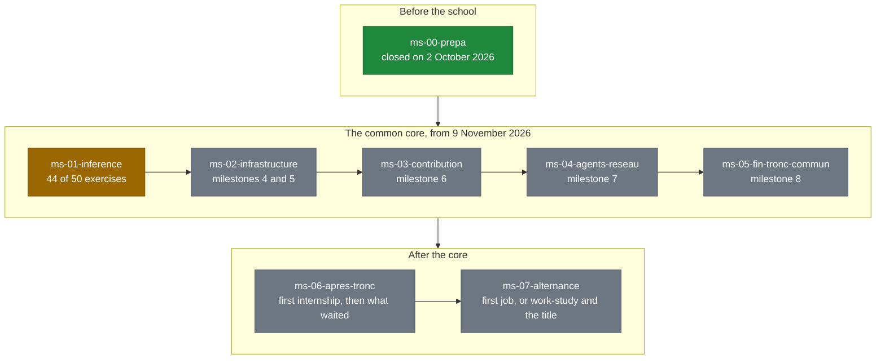
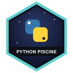
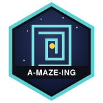
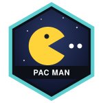
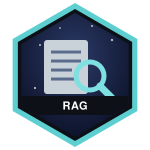
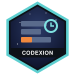
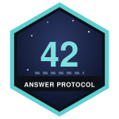

<div align="center">

# ML Systems

**From a blank file to a contribution in an inference engine.**<br>
The public trace of a roadmap toward ML systems, kept as the work happens.

<br>
<sub>in use now</sub>

<br>
<sub>ahead in the roadmap, with CUDA and Triton</sub>

`prep` → `inference` → `infrastructure` → `contribution` → `agents` → `end of core` → `internship` → `first job`

</div>

---

## What this is

ML systems is the part of machine learning that takes the model as given and
asks how to run it. What does it cost? Where does the time go? What saturates
first? What does a change actually buy? An inference server, a scheduler, a
cache or a kernel decides whether a model is usable at all.

This repository is the public trace of a roadmap toward that field. The roadmap
runs alongside the common core of the 42 school. It has eight
phases, numbered 0 to 7 like their folders, from a prep before the school to a
first job or a work-study contract. It aims at three results a reader can
check from outside:

1. the saturation curve of an unknown inference server, produced in half a day;
2. that server deployed on Kubernetes, its metrics in Prometheus, and its curve
   replayed under load;
3. a pull request in the vLLM organisation, whose review a maintainer takes up.

The CUDA kernel that beats a reference comes after the common core, once a GPU
is in reach.

Only work that survives being read by someone else lands here: code that runs,
checks that can fail, and a write-up of what each decision cost.

## Where the work stands

<!-- compteurs: written by carte_phases.py from the graders. Do not edit by hand. -->
Phase 1, [`ms-01-inference`](ms-01-inference), is the one in progress: **44 of 50 graded exercises** pass. It is paced by school milestones 1 to 3; [`ms-00-prepa`](ms-00-prepa) closed on 2 October 2026. Every number in this section is read from a grader by `carte_phases.py`, and [the phase page](ms-01-inference/README.md#what-to-do-in-order) lists the work in order with the next step marked.

| Track | State | |
|---|---|---|
| The C of the common core, milestones 1 to 3 | 4 of 10 exercises, kept out of this repository | [below](#what-is-not-here) |
| Measuring performance | ✓ 16 of 16 exercises, complete | [the phase page](ms-01-inference/README.md#what-to-do-in-order) |
| Measured inference | ✓ 24 of 24 exercises, complete | [the phase page](ms-01-inference/README.md#what-to-do-in-order) |
| L2, the throughput and latency curve | a person grades it, not a terminal | [the phase page](ms-01-inference/README.md#what-to-do-in-order) |

The denominator leaves out `l2-01-courbe` (a public write-up, graded by a reader, not by a terminal).
<!-- /compteurs -->

## The roadmap

<!-- avancement: written by carte_phases.py from the graders. Do not edit by hand. -->

<!-- /avancement -->

| Phase | Paced by | What it buys | Sub-modules |
|---|---|---|---|
| [`ms-00-prepa`](ms-00-prepa)<br>the prep, C and Python | before the school | enter the school with the libft done and a GPT trained by hand | 9 |
| **[`ms-01-inference`](ms-01-inference)**<br>graded C, measured inference | school milestones 1 to 3 | the graded C of milestones 1 to 3, and the saturation curve of an unknown inference server produced in half a day | 15 |
| [`ms-02-infrastructure`](ms-02-infrastructure)<br>Python, administration, the way in | school milestones 4 and 5 | milestones 4 and 5, then the Inception stack ported to Kubernetes, serving the L2 server with its metrics in Prometheus, Go, and the inference control layer on simulated servers | 9 |
| [`ms-03-contribution`](ms-03-contribution)<br>the school's AI projects, entering vLLM | school milestone 6 | milestone 6, starvation measured in Codexion under FIFO and EDF, a first pull request in AIBrix, the vLLM organisation's Kubernetes control plane, and interview preparation | 13 |
| [`ms-04-agents-reseau`](ms-04-agents-reseau)<br>agents, network, routing | school milestone 7 | milestone 7, with the cost per million tokens of every model in Agent Smith's report, then a Kubernetes controller in Go | 4 |
| [`ms-05-fin-tronc-commun`](ms-05-fin-tronc-commun)<br>the end of the common core | school milestone 8 | the last imposed project, crossed fast, taking its serving and monitoring part | 1 |
| [`ms-06-apres-tronc`](ms-06-apres-tronc)<br>first internship, then what waited | after the common core | the first internship at a serving or infrastructure employer, paid at least the local cost of living, then the school's specialisation toward level 14, then in order the C engine, C++, CS149, the profile, CUDA, Triton and the kernel | 44 |
| [`ms-07-alternance`](ms-07-alternance)<br>first job, or work-study and the title | after the first internship | the first job if the internship turns into one; otherwise two years of work-study in France toward 42's level 7 title | 1 |

**No estimated dates.** Two dates on this page are facts: the prep closed on
2 October 2026, and the school starts on 9 November 2026. The rest is paced,
not scheduled. The added layer moves at its own speed: the prep closed four
weeks early, and the 40 measurement and inference exercises of phase 1 were
done before the school opened. The imposed layer moves with the school's
milestones. So a phase opens on its prerequisites rather than on a date: the
order is fixed and the pace is not. The reasons are in
[`DECISIONS.md`](DECISIONS.md#why-the-roadmap-has-no-dates).

Each phase has its own page, generated from the curriculum, with its
sub-modules in the order of the work and the state of each.

## The 42 common core

The school's projects are the imposed layer of the roadmap. Their code stays
out of this repository, for the reason given [below](#what-is-not-here). This
is where each one sits.

| Milestone | Phase | Projects |
|---|---|---|
| 1 to 3 | [`ms-01-inference`](ms-01-inference) |     |
| 4 and 5 | [`ms-02-infrastructure`](ms-02-infrastructure) |       |
| 6 | [`ms-03-contribution`](ms-03-contribution) |    |
| 7 | [`ms-04-agents-reseau`](ms-04-agents-reseau) |    |
| 8 | [`ms-05-fin-tronc-commun`](ms-05-fin-tronc-commun) |  |
| after the core | [`ms-06-apres-tronc`](ms-06-apres-tronc) |  <br>and the school's specialisation |

A badge names a project, not a grade. The school grades from 9 November 2026,
and [the counters above](#where-the-work-stands) say where each project stands.
The badges come from
[ayogun/42-project-badges](https://github.com/ayogun/42-project-badges), drawn
for 42 São Paulo. That collection predates the 2026 common core, so its nine
new projects have no badge there. Theirs are home-made, in the same shape, by
[`assets/badges/draw.py`](assets/badges/draw.py).

## How it is built

- **The school comes first, and the rest is grafted onto it.** The 42 common
  core is the imposed layer. It buys the title and the time. The added layer
  is what produces anything rare, and it is what this repository holds. During
  the common core, an added module enters only when it is cheaper done together
  with a school project, or when its delay could not be caught up later.
  Everything else waits for the end of the core. A phase counts as done on its
  school milestones and their grafts.
- **A phase ends on a binary test, named in advance.** Not on a feeling, and
  not on a date. Phase 0 closed on 2 October 2026, when `gpt.py`, written from
  a blank file, passed the seven gates of [its acceptance test](#the-acceptance-test).
- **Nothing is graded by its own author alone.** Every step of the route is
  borrowed from existing work. The first ships its own grader. The chapters
  after it are graded by tests written against what each chapter states. All
  of them lead to an acceptance test written before the work, whose failure
  values are published.
- **Running is not the bar.** Being able to write it again from a blank file
  is.
- **Every check has been seen to fail.** Each one is broken on purpose before
  it is trusted. A check that cannot fail is worse than no check.

The measurements behind these rules, and every decision that changed the
roadmap, are in [`DECISIONS.md`](DECISIONS.md).

## What is already here

- **[The Python socle](PYTHON.md)**: 26 exercises in three modules, from input
  you do not control to a command installed on the PATH.
- **[The maths](MATHS.md)**: 20 exercises in three modules, in plain Python.
  Linear algebra up to a 2D transformation engine, probability held against
  closed forms, and statistics that count their own error rate.
- **[Tensor Puzzles](ms-00-prepa/rte-01-puzzles)**: Sasha Rush's twenty-one
  puzzles, each solved in one expression.
- **[Chapters 2 to 5 of the route](ms-00-prepa/rte-route-l1)**: answers to
  Raschka's book, each with tests that assert what its chapter states.
- **[L1, a GPT trained on Jules Verne](ms-00-prepa/l1-01-gpt-corpus)**: 164,065
  parameters, attention written by hand, trained in 69 seconds on a laptop
  CPU. Its dev loss is 1.7480, against 2.3928 for a counted bigram. The
  write-up replays from its folder, the weights are in
  [a release](https://github.com/maximecoia/learning_tree-ML-systems/releases/tag/l1-01-gpt-corpus-v1),
  and its [acceptance test](ms-00-prepa/l1-01-gpt-corpus/verifier.py) was
  written before the model.
- **[Measurement and measured inference](ms-01-inference/README.md#what-to-do-in-order)**:
  40 exercises in ten sub-modules, from a stopwatch that ignores warm-up to the
  point where a served model breaks under load.

Before the roadmap, in its own repository:
**[`unix-toolbox`](https://github.com/maximecoia/unix-toolbox)**. Four Unix
utilities rebuilt in C on the system calls: `mini_echo`, `mini_cat`, `mini_cp`
and `mini_wc`. The rule that every check is seen to fail holds there too. The
utilities were broken on purpose fourteen ways, and the tests catch thirteen.
That includes short writes and failing reads that no shell test can provoke,
reached by rebuilding the utilities with `write()` and `read()` redirected at
compile time.

## Phase 0: a GPT trained by hand

The prep is graded on one object: a causal GPT written from a blank file, in
`torch`, with the attention written by hand rather than called. The route to
it borrows each step from existing work.

| | Step | What grades it |
|---|---|---|
| 1 | Tensor Puzzles: 21 puzzles, one expression each, twenty of them inside eighty columns | the checker inside the notebook |
| 2 | Text data: tokenizer, sliding window, embeddings | `test_ch02.py`: upstream's test and four of mine |
| 3 | Causal attention: scores, mask, multiple heads | `test_ch03.py` |
| 4 | The GPT: blocks, normalisation, residuals, logits | `test_ch04.py` |
| 5 | Pretraining: the loop, train and validation loss, sampling | `test_ch05.py` |

Raschka's book ships almost no assertions. So the tests of steps 2 to 5 are
written here, against what each chapter states, and each suite was broken on
purpose to prove it can fail ([why](DECISIONS.md#borrowed-graders-not-written-lessons)).
They sit beside each answer, in [`ms-00-prepa/rte-route-l1`](ms-00-prepa/rte-route-l1),
and run once that directory is copied into a clone of the book.

The first assignment of CS336 used to be step 6. It left the route on
30 September 2026: its fifteen architecture-agnostic adapters graded steps 2 to
5 a second time ([why](DECISIONS.md#cs336-and-why-it-left-the-prep)). Its three
pieces that belong to Llama rather than to GPT-2, RMSNorm, SwiGLU and RoPE,
moved to [`ms-01-inference`](ms-01-inference/README.md).

### The acceptance test

It is black-box, already written, and it states what breaking each check costs,
measured against a reference implementation:
[`ms-00-prepa/l1-01-gpt-corpus/verifier.py`](ms-00-prepa/l1-01-gpt-corpus/verifier.py).
It reads tensors in and tensors out, never the architecture. Any number of
layers, heads or norms passes, as long as the model is a causal language model.

| Gate | What has to land |
|---|---|
| 1 | `(B,T) → (B,T,V)`, and no loss when no target is given |
| 2 | loss at initialisation inside `[4.12, 4.92]`, where `ln(65) = 4.1744` |
| 3 | drift **exactly 0.0** when tokens after position `t` change; dropping the mask gives 1.42e-01 |
| 4 | 0.0010 on a task only position can solve; without position embeddings it sits at 3.4658 |
| 5 | 0.0108 after 400 steps overfitting 32 fixed sequences |
| 6 | `generate` survives a context longer than the block size |
| 7 | the trained weights, measured on dev, land 0.10 below a counted bigram on the same split: 2.0856 against a bar of 2.3743, and weights never trained sit at 4.3370 |

Gates 1 to 6 grade the model, gate 7 its training. Without gate 7, a `gpt.py`
that was never trained would pass the other six.

### What closes L1

L1 comes in two parts. The phase closes on the first, and L1 itself needs both.

1. **The model.** `gpt.py`, written from a blank file, passes the seven gates
   above. A terminal grades it, through `./exo` or `python3 verifier.py`.
2. **The public write-up**, the curriculum's `l1-01-gpt-corpus`. A person
   grades it. Its one criterion is that someone else replays it without asking
   a question. It holds:
   - the chosen corpus, with its source, its licence, and a preparation script
     that rebuilds the same split;
   - the training run on that corpus, with the seed, the hyperparameters and
     the dependency versions committed, and the weights attached to a release
     rather than kept in the git history;
   - train and validation loss on one graph, the whole curve, with the step
     kept and why;
   - several unsorted samples, with their seed;
   - every number beside a baseline: validation loss against `ln(V)` and the
     bigram, the parameter count and how it was counted, the training time and
     the machine;
   - what was not tried, the bugs found afterwards, and what they change;
   - a token's path to the logits drawn from memory with its shapes, in a
     report that holds up without the code on screen.

L1 was published on 1 October 2026 and validated on 2 October 2026.

## What is not here

**The 42 subjects.** The libft and the projects that follow it are the school's
subjects. Publishing a solution to one is against its charter. This repository
is also the tree the grader reads, so finishing one here would publish it by
accident. The `.gitignore` refuses them by name, from the curriculum's own
list. What is built on top of them, like the C inference engine, lands here.

**Other people's assignments.** The book, its corpus and CS336 stay in their
own repositories. Only my answers to them are here, credited below.

**The private corpus.** The notes, lessons and study sheets that produce this
work stay private. What is published is the code typed by hand and the checks
that grade it.

## How this is verified

[`tools/check.py`](tools/check.py) asks three questions of this repository,
using nothing but this repository. Does the published Python parse? Do the
links between these pages resolve, anchors included? Does `.gitignore` agree
with what git actually tracks? Each question was proven able to fail before
being trusted, and a workflow runs all three on every push.

The pages that describe the work are generated, not written: the phase pages,
the counters, the progress chart and the tree below. They are read from the
curriculum, from the graders and from what git publishes. Each time this page
drifted in the past, the cause was a figure copied by hand. A page that reads
its sources cannot drift without them.

## Layout

One folder per phase, and inside it one folder per sub-module.

<!-- arbre: written by carte_phases.py from what git publishes. Do not edit by hand. -->
```
.github/                   the workflow that runs tools/check.py on every push
.gitignore                 what stays out, and why: 42 subjects above all
DECISIONS.md               the decisions that changed the roadmap, with their evidence
LICENSE                    MIT, and the credits owed are in Sources and licence below
MATHS.md                   the maths, module by module, and what they measured
PYTHON.md                  the Python socle, exercise by exercise
README.md                  this page: what ML Systems is, the roadmap, and where it stands
assets/                    the badges drawn for the 2026 school projects, and the script that draws them
tools/                     the checks this repository can run on itself
ms-00-prepa/               the prep, C and Python, closed on 2 October 2026
    README.md              its sub-modules in the order of the work, and their state
    py-01-basics/          correct answers out of input you do not control
    py-02-advanced/        types that make the wrong answer unrepresentable
    py-03-livrer/          the result, installable and on the PATH
    mth-01-algebre/        vectors and matrices by hand, before any library
    mth-02-probas/         a simulator held against its closed forms
    mth-03-statistiques/   whether two series really differ, and how often that is wrong
    rte-01-puzzles/        Sasha Rush's twenty-one puzzles, solved and credited
    l1-01-gpt-corpus/      L1: the GPT, its training on Jules Verne, and its acceptance test
    rte-route-l1/          the route's chapters, answers to Raschka's book
ms-01-inference/           graded C, measured inference, in progress
    README.md              its sub-modules in the order of the work, and their state
    mes-01-chronometre/    a function timed without being fooled by noise or warm-up
    mes-02-grandeurs/      orders of magnitude, estimated before any code
    mes-03-profiler/       the costly function found, and the fix proven
    inf-01-servir/         an inference engine queried and timed under a written protocol
    inf-02-prefill-decode/ prefill and decode told apart, and a cost model from them
    inf-03-llama/          RMSNorm, SwiGLU and RoPE, through CS336's public suite
    inf-04-cache-kv/       what the KV cache saves in time and costs in memory
    inf-05-quantifier/     reduced precision, its speed against its perplexity
    inf-06-harnais/        N requests in flight, and figures no trap can skew
    inf-07-saturation/     the breaking point, and the physical limit that sets it
ms-02-infrastructure/      Python, administration, the way in, its page only
ms-03-contribution/        the school's AI projects, entering vLLM, its page only
ms-04-agents-reseau/       agents, network, routing, its page only
ms-05-fin-tronc-commun/    the end of the common core, its page only
ms-06-apres-tronc/         first internship, then what waited, after the common core
    README.md              its sub-modules in the order of the work, and their state
    c-06-moteur/           the inference engine in C, its first step written ahead
ms-07-alternance/          first job, or work-study and the title, its page only
```
<!-- /arbre -->

## Sources and licence

The route: Sebastian Raschka, *Build a Large Language Model (From Scratch)*
([`rasbt/LLMs-from-scratch`](https://github.com/rasbt/LLMs-from-scratch)) ·
Sasha Rush, [Tensor Puzzles](https://github.com/srush/Tensor-Puzzles).

Further on: Stanford CS336, *Language Modeling from Scratch*
([`stanford-cs336`](https://github.com/stanford-cs336)). Its first assignment
grades three pieces of `ms-01-inference`, and its second is planned in
`ms-06-apres-tronc`.

The road that was taken off, [described here](DECISIONS.md#zero-to-hero-and-why-it-left):
the Zero to Hero lectures, notebooks and datasets are Andrej Karpathy's, under
the MIT licence: [karpathy/nn-zero-to-hero](https://github.com/karpathy/nn-zero-to-hero),
[karpathy/micrograd](https://github.com/karpathy/micrograd),
[karpathy/makemore](https://github.com/karpathy/makemore). What was built from
them here was typed, not copied, and it remains in this repository's history.

Everything else is original work, under the MIT licence.
